# รายงานตรวจมิติเสียงตัวละครและสถาปัตยกรรมการบรรยาย (Voice & Narrative POV Audit)
## โครงการนวนิยาย: The Sea That Hung Above The World

- **วันที่ตรวจวิเคราะห์:** 30 ตุลาคม 2026 (ปรับปรุงล่าสุด: 4 พฤศจิกายน 2026)
- **สถานะ:** แผนแม่บทเชิงทฤษฎีและการตรวจต้นฉบับกลาง (Master Audit & Architectural Blueprint) ฉบับสมบูรณ์สำหรับทุก Arc (บรรจุสารบบกฎสนาม 9 ประการ)
- **เอกสารอ้างอิงหลัก:** 
  - `C:\Users\super\Desktop\test\src\plan\kusabi-house\work\critique-reports\voice-dialogue-audit-2026-10-29.md` (ระเบียบวิธีตรวจมิติเสียงและบทสนทนา)
  - `src/plan/the-sea-that-hung-above-the-world/work/critique-reports/full-audit-ch01-32_2026-10-25.md` (รายงานตรวจต้นฉบับ 32 บทเดิม)
  - `src/plan/the-sea-that-hung-above-the-world/styles/voice_principles.md` (ข้อกำหนดสไตล์เดิม)

---

## สารบัญ
1. [บทนำและปัญหาแกนกลาง: กับดัก "Over-POV" (Hyper-POV Claustrophobia)](#1-บทนำและปัญหาแกนกลาง-กับดัก-over-pov)
2. [คลังข้อมูลทฤษฎีวรรณกรรมสากล: การผสานภาพรวม (Panoramic Overview) เข้ากับ POV](#2-คลังข้อมูลทฤษฎีวรรณกรรมสากล-การผสานภาพรวม-panoramic-overview-เข้ากับ-pov)
3. [รายงานตรวจมิติเสียงและบทสนทนารายตัวละคร (Voice & Dialogue Audit)](#3-รายงานตรวจมิติเสียงและบทสนทนารายตัวละคร-voice--dialogue-audit)
4. [ผ่าตัดเปรียบเทียบรูปธรรม: Before vs. After (กรณีศึกษาจากบทจริง)](#4-ผ่าตัดเปรียบเทียบรูปธรรม-before-vs-after-กรณีศึกษาจากบทจริง)
5. [กฎและพิมพ์เขียวปฏิบัติการ: เทคนิคกล้องซูมเข้า-ออก (The Accordion Technique)](#5-กฎและพิมพ์เขียวปฏิบัติการ-เทคนิคกล้องซูมเข้า-ออก-the-accordion-technique)
6. [ศาสตร์การปรับโทนตามสถานการณ์จริงและการเกลาบทสนทนา (Situational Tone & Dialogue Craft)](#6-ศาสตร์การปรับโทนตามสถานการณ์จริงและการเกลาบทสนทนา)
7. [สถาปัตยกรรมกระบวนการทำงานและกองกำลัง Subagent (Subagent Fleet & Muse Workflow)](#7-สถาปัตยกรรมกระบวนการทำงานและกองกำลัง-subagent)
8. [กฎเหล็กและข้อกำหนดเพิ่มเติมจากการผ่าตัดต้นฉบับจริง Arc 1 (Empirical Field Rules & Addendum)](#8-กฎเหล็กและข้อกำหนดเพิ่มเติมจากการผ่าตัดต้นฉบับจริง-arc-1)

---

## 1. บทนำและปัญหาแกนกลาง: กับดัก "Over-POV"

จากการตรวจอ่านร่างต้นฉบับทั้ง 35 บทของ *The Sea That Hung Above The World* ควบคู่กับการประเมินข้อสังเกตของผู้เขียน พบว่าต้นฉบับกำลังเผชิญกับวิกฤตเชิงโครงสร้างการเล่าเรื่องที่สำคัญอย่างยิ่ง นั่นคือ **"โรคติดมุมมองบุคคลที่หนึ่งในคราบมุมมองบุคคลที่สาม" (Hyper-POV Claustrophobia หรือ Over-POV Trap)**

### อาการที่ตรวจพบในตัวบท:
1. **ภาวะตาบอดทางพื้นที่ (Spatial Blindness):** 
   เนื่องจากข้อกำหนดเดิมใน `voice_principles.md` ระบุว่า *"Psychic Distance: Close/Deep POV. The narration must be filtered strictly through the active character's knowledge state, biases, and sensory limitations."* นักเขียน/AI จึงตีความกฎนี้อย่างแข็งทื่อ ส่งผลให้กล้องการเล่าเรื่องถูก "เชื่อมติดหน้าผากตัวละคร" ตลอดเวลา ผู้อ่านเห็นเพียงสิ่งที่อยู่ห่างจากปลายจมูกตัวละครไม่เกินสองฟุต (ดมกลิ่นคราบเกลือบนข้อมือ, แคะตะแกรงท่อ, สัมผัสปมเชือก, ตรวจเข็มขัด) แต่**ไม่เคยเห็นภาพรวมของโลก**
2. **การหายไปของความยิ่งใหญ่เชิงสเกล (Loss of Epic Scale & Wonder):**
   โลกของเรื่องนี้มีแนวคิดที่มหัศจรรย์ระดับมาสเตอร์พีซ: *ทะเลที่ลอยคว่ำอยู่บนท้องฟ้า (The Sky Ocean), เมืองเอลาริสที่เกาะหน้าผาสูงชันเสียดฟ้า, เรือเหาะ Albatross ที่แล่นอยู่ในช่องว่างอากาศใต้ท้องทะเลลอยฟ้า, และเมืองโบราณที่จมคว่ำหัวห้อยย้อยลงมาจากผืนน้ำด้านบน* 
   ทว่า ความยิ่งใหญ่ระดับปรากฏการณ์นี้กลับถูกบั่นทอนลงจนแบนราบ เพราะตัวละครเข้าฉากมาก็ก้มหน้าทำกิจวัตรส่วนตัวทันที ผู้อ่านไม่ได้รับรู้ถึงแรงกดดันมหาศาลของมวลน้ำนับล้านตันที่แขวนอยู่เหนือกระหม่อม หรือความเวิ้งว้างน่าหวาดเสียวของหุบเหวลึกหมื่นฟุตเบื้องล่าง
3. **การเปิดฉากแบบบล็อกเทมเพลตซ้ำซาก (Scaffolded Scene Openings):**
   เกือบทุกบทเปิดด้วยสูตรเดียวกัน:
   - บรรทัดที่ 1: ประกาศชื่อบทและ POV
   - บรรทัดที่ 2–5: สูตรนิเสธ ("ไม่ใช่สิ่งนี้... ไม่ใช่สิ่งนั้น... แต่มันคือ...")
   - บรรทัดที่ 6–10: ตัวละครตื่นขึ้นมา / ตรวจสอบ 3 สิ่งที่ต้องทำในวันนี้ / หยิบพร็อพประจำตัว

---

## 2. คลังข้อมูลทฤษฎีวรรณกรรมสากล: การผสานภาพรวม (Panoramic Overview) เข้ากับ POV

ในแวดวงวรรณกรรมระดับโลกและงานเขียนแฟนตาซี/ไซไฟมหากาพย์ (Epic Speculative Fiction) ไม่มีนักเขียนระดับปรมาจารย์คนใดขังมุมมองผู้อ่านไว้ใน Deep POV แบบ 100% ตลอดทั้งเรื่องโดยไม่เปิดภาพรวม

### 2.1 สเปกตรัมระยะห่างทางจิตวิทยา (John Gardner's 5 Levels of Psychic Distance)
จากตำราคลาสสิก *The Art of Fiction* (1983) ของ **John Gardner** ระยะห่างระหว่าง "ผู้เล่าเรื่อง" กับ "จิตสำนึกของตัวละคร" ถูกแบ่งเป็น 5 ระดับ:

| ระดับ | ชื่อระยะ | ลักษณะการทำงาน | การนำไปใช้ในนิยายระดับโลก |
| :--- | :--- | :--- | :--- |
| **Level 1** | **Panoramic / Cosmic (ภาพกว้างระดับโลก)** | บรรยายกาลเวลา ภูมิประเทศ สภาพอากาศ ประวัติศาสตร์ หรือสถานการณ์รวมของมวลชน โดยยังไม่เจาะจงตัวละคร | ใช้เปิดองก์, เปิดบท, เปลี่ยนสถานที่, หรือสร้างบรรยากาศกดดันระดับจักรวาล |
| **Level 2** | **Social / Atmospheric (ภาพรวมสถานการณ์)** | บรรยายสภาพแวดล้อมที่แวดล้อมกลุ่มคน เช่น ความคึกคักของตลาด, ความตึงเครียดของกองทหาร, สภาพเมือง | ใช้สร้างบริบทแวดล้อม (Context) เพื่อให้รู้ว่าตัวละครกำลังยืนอยู่ท่ามกลางอะไร |
| **Level 3** | **Objective Action (ภาพระยะกลางของตัวละคร)** | เห็นตัวละครก้าวเข้ามาในฉาก ปฏิสัมพันธ์ทางกายภาพกับวัตถุหรือคนอื่นจากสายตาภายนอก | ใช้จัดวางตำแหน่งตัวละครในพื้นที่ (Staging & Blocking) |
| **Level 4** | **Close POV / Free Indirect Discourse** | ภาษาบรรยายเริ่มผสมสำนวน ความรู้สึก อคติ และคำศัพท์เฉพาะของตัวละครตัวนั้น | ใช้ดำเนินฉากสนทนา การตัดสินใจ และการประเมินสถานการณ์เฉพาะหน้า |
| **Level 5** | **Visceral Interiority (จิตสำนึกชั้นในสุด)** | ความคิดดิบ ความเจ็บปวด สัญชาตญาณเอาชีวิตรอด หรือบาดแผลในใจที่ไร้การกรอง | ใช้ในจังหวะวิกฤตเฉียดตาย, ช็อก, ไคลแมกซ์, หรือช่วงอารมณ์แตกสลาย |

> **ข้อค้นพบสำคัญ (Data Insight):** นิยายระดับมาสเตอร์พีซจะใช้เทคนิค **"การซูมแบบหีบเพลง" (Accordion Motion)** กล่าวคือ เริ่มต้นฉากที่ **Level 1 หรือ 2** เพื่อสร้าง "หมุดทิศทางและบรรยากาศ" (Establishing Shot) ให้ผู้อ่านเห็นภาพรวมและสถานการณ์ จากนั้นค่อยซูมกล้องลงมาที่ **Level 3 → Level 4** เพื่อเข้าสู่เนื้อเรื่อง และผลักเข้า **Level 5** เฉพาะจังหวะวิกฤต จากนั้นเมื่อจบเหตุการณ์ใหญ่ กล้องจะซูมถอยกลับไปที่ **Level 1 หรือ 2** อีกครั้งเพื่อสรุปผลกระทบต่อภาพรวม

### 2.2 บทเรียนจากวรรณกรรมชิ้นเอก
1. **Frank Herbert (*Dune*):**
   เฮอร์เบิร์ตไม่เคยเปิดฉากด้วยพอล อะเทรีดีสนั่งดมทรายในห้อง แต่เปิดด้วยการบรรยายภูมิอากาศอันโหดร้ายของดาวอาร์ราคิส กฎเกณฑ์ของสไปซ์ และแรงกดดันทางการเมืองระดับจักรวรรดิ ก่อนจะซูมลงมายังห้องนอนของพอล ทำให้การทดสอบกล่องกอมจับบาร์มีความหมายระดับเปลี่ยนชะตากรรมดวงดาว
2. **China Miéville (*Perdido Street Station* & *The Scar*):**
   มิเอวิลล์เปิดฉากด้วยภาพพาโนรามาอันบ้าคลั่งของเมืองนิวโครบูซอน หรือมหานครลอยน้ำอาร์มาดา กลิ่นควันพิษ แม่น้ำขุ่นข้น ความแออัดของชนชั้นแรงงาน เมืองทำหน้าที่เป็น "สิ่งมีชีวิตขนาดยักษ์ที่กดทับตัวละคร" หากปราศจากการบรรยายภาพรวม ผู้อ่านจะไม่มีวันสัมผัสถึงความอึดอัดของโลกใบนี้ได้เลย
3. **George R.R. Martin (*A Song of Ice and Fire*):**
   แม้จะเป็นบทมุมมองจำกัดบุคคลที่สาม (Third-Person Limited) แต่ทุกบทจะเริ่มต้นด้วยการสถาปนาพื้นที่: สายลมหนาวที่พัดผ่านกำแพงน้ำแข็ง, ธงตระกูลที่สะบัดท่ามกลางฝนโคลน, รอยแตกของหินแกรนิตในปราสาทวินเทอร์เฟล เมื่อผู้อ่านเห็นภาพรวมของสถานการณ์แล้ว ความกลัวของแบรนหรือความเย้ยหยันของทีเรียนจึงมีเวทีรองรับที่มั่นคง

---

## 3. รายงานตรวจมิติเสียงและบทสนทนารายตัวละคร (Voice & Dialogue Audit)

อ้างอิงตามระเบียบวิธีตรวจของ Kusabi House (`voice-dialogue-audit-2026-10-29.md`) เราจะไม่ตัดสินตัวละครจาก Bio หรือ MBTI แต่จะตัดสินจาก **"คำที่ปรากฏจริงบนหน้ากระดาษและปฏิสัมพันธ์ต่อคนตรงหน้า"**

### 3.1 Cael Arvane (คาเอล)
- **สถานะเดิม:** ถูกขังอยู่ในบทบาท "คนฟังท่อ/คนล้างตะแกรง" มากเกินไป กิจวัตรของเขาคือการก้มมองน้ำ ดมกลิ่นเกลือ นับปมเชือก และรายงานเสียงสั้นๆ จนเกือบกลายเป็นตัวละครรับสาร (Passive Observer) ที่ไร้พลังขับเคลื่อน
- **จุดที่ต้องแก้ (High Priority):**
  1. **สิทธิ์ในการมองเห็นและการตัดสินใจ:** คาเอลต้องไม่ใช่แค่ "หูของทีม" แต่เป็นคนที่มีความรู้ทางชลศาสตร์และวิศวกรรมการระบายน้ำของเมืองเก่า บทพูดของเขาควรให้ทางเลือกและวิธีแก้ปัญหาเชิงพื้นที่ ไม่ใช่แค่บอกว่า "ผมได้ยินเสียง"
  2. **การปฏิสัมพันธ์กับผู้มีอำนาจ:** เมื่อเผชิญหน้ากับสภาศิลาหรือทหารกระทรวง บทพูดของคาเอลต้องสะท้อน "ความเงียบที่มีน้ำหนัก" (Calibrated Restraint) ไม่ใช่ความกลัวแบบเด็กน้อย
  3. **คำเรียกตนเองและผู้อื่น:** ยึดสรรพนาม `ผม` เป็นหลัก และเรียกผู้อื่นด้วยชื่อหรือตำแหน่งอย่างให้เกียรติ แต่ในภาวะคับขัน (เช่น บทที่ 30 ขึ้นไปเมื่อร่างกายเริ่มแปรสภาพ) ภาษาของเขาต้องเปลี่ยนผ่านไปสู่ความรู้สึกเชื่อมโยงกับมวลน้ำและฝูงวาฬอย่างเป็นลำดับขั้น

### 3.2 Ilyra Venn (อิไลรา)
- **สถานะเดิม:** ถูกล็อกให้เป็น "สาวแอ็กทีฟจอมปล่อยมุก/กัปตันหนี้ท่วมหัว" ทำให้หลายครั้งบทสนทนาของเธอดูกลบเกลื่อนเรื่อยเปื่อย กลายเป็นตัวตลกประจำกลุ่มที่คอยตัดมุกใส่คนอื่น
- **จุดที่ต้องแก้ (High Priority):**
  1. **น้ำหนักของกัปตันเรือบิน (Nautical Authority):** อิไลราคือคนที่คุมหางเสือเรือ *Albatross* รอดพายุและแนวปะการังลอยฟ้ามาเป็นสิบปี คำสั่งของเธอต้องกระชับ เด็ดขาด มีศัพท์การบินและลมที่แม่นยำ ผู้อ่านต้องเชื่อว่าลูกเรือพร้อมฝากชีวิตไว้กับเธอ
  2. **จังหวะของหน้ากาก (Mask vs. Still):** ลดการเล่นมุกแบบพร่ำเพรื่อ มุกตลกและการประชดของเธอจะทำงานได้ทรงพลังที่สุดเมื่อใช้ "กลบความเงียบและความกลัวของลูกเรือ" ไม่ใช่ใช้ในขณะที่คนอื่นกำลังบาดเจ็บจริง
  3. **ตัดคำสร้อยนิเสธ:** เลิกใช้ความคิดเปิดฉากแบบ "ถ้าถามอิไลรา... คำตอบจะไม่ใช่... แต่เป็น..." ซึ่งเป็นแม่แบบ AI ที่ทำลายเอกลักษณ์เฉพาะตัว

### 3.3 Maera Sol (เมรา)
- **สถานะเดิม:** ถูกกำกับด้วยโจทย์ "สาวเท่พูดน้อย/ช่างเครื่องปากร้าย" จนบางช่วงกลายเป็นหุ่นยนต์รายงานตัวเลขแรงบิด (Torque) และค่าความเสียหาย (DPH) ซ้ำไปซ้ำมา
- **จุดที่ต้องแก้ (Medium Priority):**
  1. **เปลี่ยนคำด่าให้เป็นการกระทำเชิงช่าง:** เมราไม่จำเป็นต้องคอยพูดจิกกัดโทวินหรือลูกเรือตลอดเวลา ความห่วงใยของเธอแสดงออกได้ดีที่สุดผ่าน "การลงมือซ่อมของให้คนอื่นตอนกลางคืน" โดยไม่พูดอะไร
  2. **จังหวะภาษา:** เมื่ออธิบายปัญหาเครื่องจักร ให้ใช้ศัพท์ช่างที่เห็นภาพความเสื่อมสภาพของโลหะจริง (รอยร้าวตามแนวเชื่อม, ความล้าของสปริง, คราบเขม่าอุดตัน) มากกว่าการท่องตัวเลขลอยๆ

### 3.4 Sera Quill (เซรา)
- **สถานะเดิม:** เสียงของเธอมักถูกใช้เป็น "เครื่องมือเล่า Lore ประจำเรื่อง" (Exposition Delivery Machine) ตัวละครเดินมาเจอเอกสาร เซราก็อ่านและอธิบายประวัติศาสตร์ยืดยาว
- **จุดที่ต้องแก้ (High Priority):**
  1. **เปลี่ยนบทบรรยายประวัติศาสตร์เป็นการสืบสวน:** เซราต้องสงสัย ชั่งน้ำหนักความน่าเชื่อถือของตราประทับ เปรียบเทียบความขัดแย้งของบันทึกราชการกับสภาพความเป็นจริง ไม่ใช่เชื่อเอกสารทุกแผ่นทันที
  2. **ความเย่อหยิ่งของปัญญาชนที่ถูกโลกความจริงตบหน้า:** เธอต้องมีช่วงเวลาที่ทฤษฎีในหอจดหมายเหตุใช้การไม่ได้เมื่ออยู่กลางพายุทะเลฟ้า

### 3.5 Nio Arvane (นีโอ)
- **สถานะเดิม:** สรรพนามหลุดสลับไปมาระหว่าง `ผม`, `ฉัน`, และ `มัน` ข้ามหลายบท (ตามที่ตรวจพบในรายงาน 25 ต.ค.) และมักหลุดพูดประโยคปรัชญายาวๆ แบบผู้ใหญ่ทั้งที่เส้นเสียงและสมองกำลังตกผลึก
- **จุดที่ต้องแก้ (Crucial Priority):**
  1. **สถาปนา "บันไดการสูญเสียภาษา" (Language Loss Progression):** 
     - *อดีต (Flashback):* เด็ก 4 ขวบ พูดจาไร้เดียงสา ใช้คำสั้นๆ เรียกคาเอลว่า "พี่"
     - *ปัจจุบันช่วงต้น–กลาง (Arc 3–4):* คำพูดเริ่มขาดช่วงเป็นห้วงๆ เสียงแหบแห้งเหมือนเม็ดทรายเสียดสี พูดเฉพาะคำนามและกริยาสั้นๆ เช่น "เกลือ", "หนาว", "กลับบ้าน", "ช่วย" ห้ามพูดประโยคซับซ้อนหรือคำคมปรัชญาเด็ดขาด
     - *ปัจจุบันช่วงวิกฤต–ท้าย (Arc 5–7):* สูญเสียคำศัพท์พื้นฐานทีละคำ (เช่น ลืมคำว่า "น้ำ", ลืมคำว่า "พี่") สื่อสารผ่านความถี่เสียง การเคาะจังหวะสามโน้ต และคลื่นสะท้อนแบบวาฬ

### 3.6 ตัวละครสายทหาร นักล่า และองค์กรอำนาจ (Cassian, Odran, Loran, Varek, Antagonists)
- **Cassian Veyr & Loran Thorne (อดีตนายทหารและผู้นำร่อง):**
  - ต้องรักษาเกียรติภูมิความสุขุมแบบนายทหารผ่านศึก ใช้สรรพนาม `ผม-คุณ` หรือเรียกยศ/นามสกุล (`ผู้การ`, `จ่า`, `รัสค์`)
  - **ข้อห้าม:** ห้ามหลุดด่าทอด้วยคำว่า `"แก-แก"` แบบนักเลงข้างถนน ห้ามพูดคำสแลงวัยรุ่น (`"ใช่ป่ะ"`) และห้ามพูดจาอ่อนน้อมแบบพนักงานบริการลูกค้า
- **Odran Vale (อดีตผู้คุมผู้แบกรับตราบาป):**
  - น้ำเสียงหนักแน่น สุภาพ เต็มไปด้วยความรู้สึกผิดที่กดทับ ใช้สรรพนาม `ผม-คุณ` ทุกการตัดสินใจต้องยึดโยงกับหนี้ชีวิตของเด็กทั้ง 73 คนใน Salt Ward ไม่ใช่คำพูดปลุกใจแบบการ์ตูนทั่วไป
- **Varek (นักล่าแดงผู้ติดเชื้อ):**
  - อันตราย เงียบขรึม พูดเฉพาะสิ่งที่เกี่ยวกับความอยู่รอดและการล่า ใช้สรรพนาม `ผม-คุณ` หรือละสรรพนาม
  - **ข้อห้าม:** ห้ามเติมคำลงท้าย `"ครับ"` แบบสุภาพชนทั่วไป และห้ามใช้สรรพนามโบราณ `ข้า-เจ้า`
- **ตัวละครกลุ่มอำนาจโบราณ / จิตสำนึกรวม / นักบุญ (เช่น Dead Parliament, Marrow Saint, Warden):**
  - **จิตสำนึกแช่แข็ง (Consciousness Archives):** ไม่ใช่ AI หรือคอมพิวเตอร์สมัยใหม่ ห้ามใช้ศัพท์ไอที (เช่น *อัลกอริทึม, ดาต้าเบส, ประมวลผล, ระบบรวน*) ให้ใช้ภาษาทางคณิตศาสตร์ กลศาสตร์ชลศาสตร์ และปรัชญาการเอาชีวิตรอดที่เย็นชาไร้ความลังเล
  - **ผู้ปกครอง/นักบุญผู้ควบคุมระบบ:** ต้องพูดด้วยความสุภาพ นุ่มนวล มีเหตุผลที่น่าขนลุก ไม่ข่มขู่โวยวายแบบตัวร้ายเกรดต่ำ

---

## 4. ผ่าตัดเปรียบเทียบรูปธรรม: Before vs. After

### กรณีศึกษาที่ 1: บทที่ 1 (เปิดฉากเมืองเอลาริส และคาเอล)

#### ❌ ร่างเดิม (Over-POV คลั่งแคบ — โฟกัสแต่ตัวบุคคล):
```markdown
เสียงน้ำในท่อวันนี้ไม่เหมือนเดิม

มันเปลี่ยนไปตั้งแต่ก้าวแรกที่เท้าแตะบันไดหิน กลิ่นเปลี่ยนก่อนเสียงเปลี่ยน กลิ่นเกลือลอยขึ้นมาจากใต้เมือง กลิ่นแบบนี้ปกติมีเฉพาะหน้าฝน แต่ตอนนี้ยังไม่ถึงฤดู ฟ้ายังใสอยู่ ไม่มีเมฆสักก้อน แต่กลิ่นมันมาก่อน

เขาลงบันไดผ่านตลาดชั้นล่าง ร้านขายผักเพิ่งเปิด แม่ค้าหาบตะกร้าสองใบขึ้นจากชั้นสาม หมาหัวล้านตัวหนึ่งนอนขวางทางเดิน ไม่มีใครเดินอ้อม มันยอมขยับเองเมื่อแดดมาถึง

เขาคุกเข่าลงข้างตะแกรงเหล็ก เช็ดมือกับผ้าขี้ริ้วที่พันเอว ก่อนจะจุ่มมือลงในน้ำเย็นที่ไหลเอื่อย...
```

#### ✅ ข้อเสนอปรับปรุงใหม่ (Panoramic Wide Shot → Medium Staging → Close POV):
```markdown
เมืองเอลาริสถูกสร้างขึ้นบนหน้าผาหินชัน แขวนตัวอยู่ระหว่างสองความว่างเปล่า

เบื้องล่างคือหุบเหวลึกสุดหยั่งที่จมอยู่ใต้ทะเลหมอกสีเทา ส่วนเบื้องบน—ห่างออกไปเพียงไม่กี่พันเมตรเหนือยอดเขาหินปูน—คือผืนน้ำสีเขียวมรกตขนาดยักษ์ที่ไร้ขอบเขต 'ทะเลฟ้า' ลอยคว่ำตัวอยู่อย่างเงียบงัน บดบังแสงตะวันจนทั้งเมืองตกอยู่ใต้แสงสลัวอมเขียวเหมือนก้นมหาสมุทร บ้านเรือนที่สร้างซ้อนลดหลั่นกันเป็นชั้นๆ เกาะเกี่ยวอยู่กับชะง่อนผา ทอดเงาทับกันลงมาเป็นหลืบมืด บันไดหินคดเคี้ยวชื้นแฉะด้วยละอองน้ำเค็มที่ระเหยร่วงลงมาจากเบื้องบนตลอดทั้งปี

เช้าตรู่วันนี้ ลมตะวันตกไม่พัด

ความเงียบผิดฤดูกาลเข้าปกคลุมตลาดคราบสมุทรชั้นล่างสุด แผงค้ายังปิดทึบ มีเพียงคราบฝุ่นเกลือขาวที่ถูกลากเป็นทางยาวนำไปสู่ประตูเมือง และกลิ่นความชื้นเข้มข้นที่ดันย้อนขึ้นมาจากระบบท่อระบายน้ำใต้เมือง

Cael Arvane ก้าวลงมาถึงขั้นบันไดสุดท้าย

สองเข่าของเขาทรุดลงบนพื้นหินเปียกชื้นอย่างคุ้นชิน ปลายนิ้วสัมผัสตะแกรงเหล็กขึ้นสนิมที่ขวางปากท่อระบายน้ำหลัก สายน้ำที่ไหลรอดใต้ฝ่าเท้าควรจะกระทบขอบเหล็กเป็นจังหวะสม่ำเสมอเหมือนนาฬิกาที่ไขไว้ล่วงหน้าสิบปี แต่วันนี้ จังหวะของมันกระตุก ขาดหาย แล้วสำลัก

เหมือนบางสิ่งที่มีชีวิต กำลังพยายามหายใจย้อนขึ้นมาจากความลึก
```

---

### กรณีศึกษาที่ 2: บทที่ 3 (เปิดฉากเรือ Albatross และอิไลรา)

#### ❌ ร่างเดิม (AI Scaffold & Negation Cliché):
```markdown
ถ้าถาม Ilyra Venn ว่าอะไรในโลกนี้ที่ไว้ใจไม่ได้ที่สุด
คำตอบของเธอจะไม่ใช่พวกทหารกระทรวง
ไม่ใช่สภาพอากาศที่แปรปรวนบนเทือกเขาเอลาริส
และไม่ใช่แม้กระทั่งราคาเหล้าองุ่นหมักในตลาดชั้นล่าง
แต่เป็นเครื่องยนต์ไฮบริดไอน้ำอัดแรงดันของเรือ Albatross

ก่อนที่แสงแรกของวันจะสาดส่องผ่านรอยแยกของแนวผาหิน
Ilyra ตื่นขึ้นมาในเปลญวนผ้าใบเก่าที่ขึงอยู่ใต้ท้องเรือ...
กลิ่นแรกที่ปลุกเธอให้ตื่นไม่ใช่กลิ่นขนมปังอบใหม่
ไม่ใช่กลิ่นกาแฟต้มหอมกรุ่น...
```

#### ✅ ข้อเสนอปรับปรุงใหม่ (Establishing the Ship & Abyssal Environment):
```markdown
ที่ระดับความสูงสองพันเมตรเหนือหุบผาเอลาริส ช่องว่างระหว่างผืนแผ่นดินกับท้องน้ำเบื้องบนบีบแคบลงจนเหลือเพียงช่องลมแคบๆ ที่กระแสอากาศหมวนวนอย่างบ้าคลั่ง

เรือ *Albatross* จอดเทียบอยู่กับเครนไม้โบราณที่ยื่นพ้นแนวผาหิน ตัวเรือยาวสี่สิบเมตรทำจากไม้โอ๊กแช่เกลือหุ้มเกราะทองเหลืองบาง ปีกกลสองข้างกางพะเยิบรับลมหนาวที่กรีดผ่านช่องเขา สายเคเบิลรัดโยงเรือเข้ากับหมุดหินส่งเสียงครวญครางตึงเปรี๊ยะตามจังหวะกระโชก ด้านล่างของกราบเรือคือความเวิ้งว้างว่างเปล่าที่หากก้าวพลาดจะไม่มีสิ่งใดรองรับร่างไปจนถึงก้นหุบเขา

แต่สิ่งที่น่ากลัวกว่าความสูง คือเพดานเบื้องบน

ผืนน้ำสีครามของทะเลฟ้าห้อยย้อยลงมาเป็นระลอกคลื่นกลับหัว แสงสว่างแรกของรุ่งอรุณส่องทะลุผ่านความหนาของมวลน้ำ หักเหเป็นลำแสงสีครามแกมทองสาดลงมากระทบดาดฟ้าเรือ ฝูงปลาบินตัวเล็กๆ ว่ายวนอยู่ตามผิวน้ำที่แขวนอยู่เหนือเสากระโดงเรือเพียงไม่กี่ร้อยหลา

ใต้ท้องเรืออันมืดสลัว เครื่องยนต์หม้อต้มไอน้ำสำลักไอร้อนออกมาเป็นจังหวะหนักแน่น

Ilyra Venn ก้าวพ้นประตูดาดฟ้าขึ้นมารับลมหนาว เสื้อโค้ตหนังตัวยาวของเธอสะบัดตีกับกราบเรือ รอยด่างเกลือสีขาวเกาะกรังอยู่ตามชายเสื้อ มือข้างหนึ่งของเธอแตะพังงาไม้ที่ขัดจนขึ้นเงา สายตาของกัปตันไม่ได้มองที่พื้นกระดาน แต่กวาดมองแนวเมฆหมอกทิศเหนือที่กำลังก่อตัวเป็นกำแพงทึบ

"ลมยกตัวกำลังเปลี่ยนทิศ" เธอพูดกับความเงียบของรุ่งสาง "ถ้าหม้อต้มของเมราไม่ระเบิดไปเสียก่อน เที่ยงนี้เราจะได้รู้กันว่าสุสานซากเรือยังอยู่ที่เดิมไหม"
```

---

## 5. กฎและพิมพ์เขียวปฏิบัติการ: เทคนิคกล้องซูมเข้า-ออก (The Accordion Technique)

```
[ระดับ 1: Panoramic Wide Shot] — สถาปนาภูมิประเทศ/สภาพอากาศ/ความยิ่งใหญ่ของทะเลฟ้า (10-15%)
       ↓ ซูมเข้า
[ระดับ 2: Situational Mid Shot] — จัดวางพื้นที่ สภาพเมือง การเคลื่อนไหวของฝูงชน หรืออาการของเรือ (20%)
       ↓ ซูมเข้า
[ระดับ 3: Character Close-Up] — ตัวละครลงมือกระทำทางกายภาพในพื้นที่นั้นจริง (30%)
       ↓ ซูมเข้า
[ระดับ 4-5: Deep POV & Dialogue] — ความคิด บทสนทนา อคติ และการปะทะอารมณ์ (35-40%)
       ↑ ซูมออก (เมื่อจบบทหรือเปลี่ยนฉากใหญ่)
[กลับสู่ระดับ 1-2] — ภาพกว้างเพื่อทิ้งน้ำหนักอารมณ์และแรงกระเพื่อมต่อโลก
```

### บัญญัติ 5 ประการในการรีไรต์ (Rewriting Mandates):
1. **ห้ามเปิดฉากด้วยกิจวัตรย่อยโดยไม่มีฉากหลัง:** ทุกบทต้องเริ่มด้วยการจัดวางพื้นที่ (Orientation) ให้ผู้อ่านรู้ว่าตัวละครกำลังยืนอยู่จุดไหนในโลก ความสูงเท่าใด สภาพอากาศเป็นอย่างไร และอันตรายรอบตัวคืออะไร
2. **แบนสูตรปฏิเสธซ้ำซาก (Ban Negative Listing Cliché):** เลิกใช้แพตเทิร์น *"ไม่ใช่ A... ไม่ใช่ B... แต่เป็น C"* เด็ดขาด ให้บรรยายสิ่งที่ *มีอยู่จริง* และส่งผลกระทบต่อประสาทสัมผัสโดยตรง
3. **ใช้ฉากเป็นแรงกดดัน (Setting as Active Pressure):** ทะเลฟ้า, เหวลึก, ละอองเกลือ, และกลิ่นสนิม ต้องไม่ใช่แค่วอลเปเปอร์ประดับฉาก แต่ต้องมีปฏิสัมพันธ์กับเนื้อเรื่อง
4. **ตัดบทสนทนาแบบรายงาน Lore (No Exposition Disguised as Dialogue):** ตัวละครต้องไม่พูดข้อมูลที่ทุกคนในโลกรู้อยู่แล้วเพียงเพื่ออธิบายให้คนอ่านฟัง บทพูดต้องเป็นการต่อรอง ซ่อนเร้น สั่งการ หรือปะทะกันทางอำนาจ
5. **รักษาเสถียรภาพสรรพนามและเสียงเฉพาะตัว (Pronoun & Voice Integrity):** กวาดล้างจุดสลับ `ผม/ฉัน/ข้า` ทั้งหมดให้ตรงตามตารางกลางที่ล็อกไว้

---

## 6. ศาสตร์การปรับโทนตามสถานการณ์จริงและการเกลาบทสนทนา (Situational Tone & Dialogue Craft)

บทเรียนสำคัญที่สุดจากการเกลา *Kusabi House* คือ **"อย่าล็อกบุคลิกตัวละครด้วยสรรพนามหรือคำลงท้ายเพียงชุดเดียวจนกลายเป็นรูปปั้นแบนแต๊ดแต๋"** มนุษย์จริงจะเปลี่ยนระดับภาษา จังหวะการพูด และความยาวประโยคตาม "แรงกดดันของสถานการณ์" เสมอ

### 6.1 การปรับระดับภาษาตามสถานการณ์ (Dynamic Register Modulation Matrix)

| สถานการณ์ | ระดับภาษาและจังหวะประโยค | คำลงท้าย / อนุภาคคำพูด | ตัวอย่างในเรื่อง The Sea |
| :--- | :--- | :--- | :--- |
| **1. ยามสงบ / ในวงเพื่อนสนิท** | ประโยคยาวไหล มีมุกหยอกล้อ จังหวะหายใจสบายๆ | ใช้คำแสดงความรู้สึกและชี้ทิศ: *"แฮะ, นะ, ล่ะ, หรอก, เนอะ"* | อิไลราแหย่เมราเรื่องหม้อต้มไอน้ำ / เมราด่ากลับด้วยความนิ่ง |
| **2. วิกฤตเฉียดตาย / ภัยพิบัติทางอากาศ** | ประโยคสั้นกุด ขาดช่วง ไร้คำขยาย ละประธาน คำสั่งเด็ดขาด | **ตัดคำสร้อย 100%** (ห้ามมี "ว่ะ/ครับ/ค่ะ/มั้ง/นะ") มีแต่คำกริยาทางกายภาพ | *"ดึงคันโยก!" "ปีกซ้ายฉีก!" "ทิ้งสมอเดี๋ยวนี้!"* ไม่พูดเล่นเด็ดขาด |
| **3. เผชิญหน้าอำนาจ / การสืบสวน** | สุภาพแต่รักษาระยะห่าง ประโยคระวังตัว มีคำถามย้อน | สุภาพตามบทบาท: *"ครับ/ค่ะ/ท่าน"* เพื่อสร้างเกราะกำแพง | เซราและคาเอลตอบคำถามสภาศิลาไร้ฝน รักษาระยะไม่ยอมเปิดเผยความลับ |
| **4. ความเปราะบาง / แตกสลาย** | ประโยคแผ่วเบา มีรอยเงียบ (Silence) คำพูดไม่สมบูรณ์ | ละสรรพนาม พูดลอยๆ ไม่มีคำลงท้ายประดิษฐ์ | คาเอลนึกถึงนีโอตอนเด็ก / นีโอสูญเสียคำพูดและร้องเป็นทำนองสามโน้ต |

### 6.2 การปลดล็อกสรรพนามและอนุภาคกลวง (Pronoun & Particle Decoupling)
- **สรรพนามไม่ใช่ป้ายชื่อ:** ในชีวิตจริง เมื่อคนเราคุยกัน เราจะไม่เอ่ยสรรพนาม "ฉัน/แก/เธอ/นาย" ทุกบรรทัด ให้ใช้การ **ละสรรพนาม (Subject Ellipsis)** อย่างเป็นธรรมชาติในภาษาไทย เช่น *"กินข้าวยัง"* แทนที่จะเป็น *"เธอไปกินข้าวมาหรือยัง"*
- **คำว่า "ครับ/ค่ะ" ไม่ใช่สัญลักษณ์เดียวของความดี:** ความสุภาพที่แท้จริงเกิดจากน้ำเสียงและการให้เกียรติ ไม่ใช่การยัด "ครับ/ค่ะ" ต่อท้ายทุกประโยคจนล้นเอียน
- **คำว่า "วะ/ว่ะ" ใช้ได้เมื่อ "Earned" เท่านั้น:** ใช้เฉพาะตอนสติแตก ตวาด สับสนอย่างรุนแรง หรือในจังหวะสบถเปิดเผยบาดแผล ห้ามนำมาใช้เป็นคำสร้อยติดปากพร่ำเพรื่อในบทบรรยายธรรมดา

### 6.3 กฎการตัดจบตามธรรมชาติ (Natural Termination & Mood Makers)
- **ห้ามสนทนาวนในอ่าง (No Circular Arguments):** เมื่อตัวละครเถียงกันจนจุดยืนชัดเจน หรือความจริงถูกเปิดเผยแล้ว **ต้องสั่งหยุดบทสนทนาทันที**
- **Mood Makers (ตัวเปลี่ยนบรรยากาศ):** ใช้ความเงียบ การขยับตัว หรือการเปลี่ยนแปลงของสิ่งแวดล้อมมาเป็นตัวตัดบท เช่น:
  - เสียงลมพายุหวีดหวิวผ่านเสากระโดงเรือ
  - เสียงเครื่องจักรสำลักไอน้ำ
  - ตัวละครคนหนึ่งหันหลังเดินไปที่พังงา หรือวางถ้วยชาลงบนโต๊ะ

### 6.4 บทสนทนาสองหน้าที่ (Dual-Purpose Dialogue & Subtext)
ทุกประโยคที่ตัวละครพูดต้องทำหน้าที่อย่างน้อย 2 อย่างพร้อมกัน:
1. เผยนิสัย/บาดแผลในใจ + ขับเคลื่อนพล็อต
2. ปกปิดความลับ + ท้าทายอำนาจของคนตรงหน้า
3. แสดงความห่วงใย + รักษาระยะห่างทางอารมณ์

---

## 7. สถาปัตยกรรมกระบวนการทำงานและกองกำลัง Subagent (Subagent Fleet & Muse Workflow)

### 7.1 ปรัชญาการทำงาน: อ่านลึกซึ้งและเขียนจริงแบบ Manual (ห้ามใช้สคริปต์อัตโนมัติ)
โครงการนี้ยึดถือระเบียบปฏิบัติตาม Muse Core Identity (`.agents/rules/core_workflow.md`) อย่างเคร่งครัด:
- **ห้ามรันสคริปต์ Python เพื่อ Find-and-Replace หรือ Auto-edit ตัวบทเด็ดขาด:** ภาษาไทยมีจังหวะ ความลื่นไหล และบริบทแวดล้อมที่สคริปต์ไม่เข้าใจ การตัดคำแบบ Regex จะทำให้ประโยคแหว่ง กลวง และเสียน้ำหนักอารมณ์
- **การแก้ไขต้องทำทีละจุดผ่านมนุษย์และ AI (Manual Surgical Line Editing):** เปิดไฟล์ต้นฉบับ อ่านทวนบริบทหน้า-หลัง ตรวจสอบ psychic distance แล้วเกลาประโยคทีละบรรทัด

### 7.2 การคำนวณขนาดกองกำลัง Subagent (Subagent Fleet Sizing)

นวนิยาย *The Sea That Hung Above The World* มีไฟล์ร่างทั้งสิ้น **36 ไฟล์** (ความยาวรวมกว่า 31,800 บรรทัด):
- `prologue.md` (บทนำ)
- Arc 1: `chapter_01.md` ถึง `chapter_06.md` (6 บท)
- Arc 2–7: `chapter_07.md` ถึง `chapter_35.md` (29 บท)

#### การจัดสรรสัดส่วน 1 Subagent ต่อ 3–4 บท:
เพื่อให้ Subagent แต่ละตัวสามารถอ่านแบบ **Line-by-line โดยละเอียด ห้ามข้าม และไม่ประสบปัญหา Context Truncation หรือจำรายละเอียดไม่ได้**:

$$\frac{36 \text{ บท}}{3 \text{ บท/ตัว}} = 12 \text{ Subagents}$$

เราจึงวางผัง **กองกำลัง 12 ทีมตรวจหลัก (Critic Squad) + 2 ผู้เชี่ยวชาญเฉพาะทาง (Specialist Squad) + 1 วาทยกรใหญ่ (Lead Architect / Muse Synthesizer)** ดังนี้:

```mermaid
flowchart TD
    Lead["Lead Architect / Muse Synthesizer\n(Antigravity — วาทยกรควบคุมภาพรวม สังเคราะห์ และนำทีมแก้)"]
    
    subgraph Fleet["12 Critic Subagents (อ่านละเอียด Line-by-line ทีมละ 3 บท)"]
        A01["Agent 01: บทนำ + บทที่ 01–02\n(Elaris, Cael Morning, Nio Flashback)"]
        A02["Agent 02: บทที่ 03–05\n(Albatross, Ilyra, Takeoff, Sky-Shelf)"]
        A03["Agent 03: บทที่ 06–08\n(First Night, Inverted Sunken City, Outer Edge)"]
        A04["Agent 04: บทที่ 09–11\n(Northern Fog, Capital Approach, Salt Ward Register)"]
        A05["Agent 05: บทที่ 12–14\n(Salt Ward Infiltration, Escape, Depth Horror)"]
        A06["Agent 06: บทที่ 15–17\n(Airship Pursuit, Engine Breakdown, Reefs)"]
        A07["Agent 07: บทที่ 18–20\n(Mistwood Approach, Varek Meeting, Red Coral)"]
        A08["Agent 08: บทที่ 21–23\n(Second Book, Tide Currents, Leviathan Song)"]
        A09["Agent 09: บทที่ 24–26\n(Sky-Dam Breach, 340-Second Count, Arm Burn)"]
        A10["Agent 10: บทที่ 27–29\n(Dam Climax, Cael Sensory Shift to Rain)"]
        A11["Agent 11: บทที่ 30–32\n(Hallowmere Defense, Odran Death, Cassian Stand)"]
        A12["Agent 12: บทที่ 33–35\n(Final Leviathan Resolution, Epilogue, Museum)"]
    end

    subgraph Specialists["2 Cross-Arc Specialists (ผู้ตรวจมิติข้ามอาร์ก)"]
        SpecA["Specialist A: Continuity & Lore Auditor\n(คณิตทะเบียน Salt Ward, 73 vs 74 ชื่อ, ร้อยปี vs พันปี)"]
        SpecB["Specialist B: Voice & Pronoun Matrix Auditor\n(ตรวจสลับ ฉัน/ผม/ข้า, บันไดเสียภาษาของ Nio)"]
    end

    Lead --> Fleet
    Lead --> Specialists
    Fleet --> Lead
    Specialists --> Lead
```



### 7.3 วงรอบการทำงาน 5 ขั้นตอน (The 5-Phase Revision Workflow)

1. **Phase 1: Fan-Out Audit (ระดมพล 12+2 Subagents):**
   ส่ง Subagent ประจำการตามบล็อกที่รับผิดชอบ อ่านต้นฉบับแบบละเอียด ตรวจจับ 3 มิติหลัก:
   - จุดที่ติดกับดัก Over-POV (ขาดภาพกว้างและการจัดวางพื้นที่)
   - จุดที่ภาษาแข็งทื่อ สรรพนามหลุด หรือมี AI scaffold (สูตรปฏิเสธ)
   - ความขัดแย้งของ Lore และตัวเลข
2. **Phase 2: Master Synthesis (Muse รวบรวมและชี้ขาด):**
   รวบรวมรายงานจาก Subagent ทั้งหมด คัดแยกความสำคัญ จัดลำดับ High / Medium / Low แก้ไขข้อขัดแย้ง และสร้างตารางแก้นำร่อง
3. **Phase 3: The Establishing Shot Ingestion (ฉีดภาพพาโนรามาเปิดฉาก):**
   นำเทคนิค Accordion Staging (Level 1–2) เข้าไปเขียนเปิดหัวฉากในแต่ละบท สถาปนาความยิ่งใหญ่ของทะเลฟ้า ความสูง และสภาพอากาศ
4. **Phase 4: Surgical Line-by-Line Rewriting (ลงมือเกลาประณีตรายบท):**
   ปรับปรุงบทสนทนา ขจัดสรรพนามขยะ คืนน้ำหนักให้ตัวละคร (คาเอลมีอำนาจตัดสินใจ, อิไลรามีน้ำเสียงกัปตัน, เมราแสดงความห่วงใยด้วยงานช่าง)
5. **Phase 5: Final Convergence & Verification (การตรวจประเมินปิดงาน):**
   สแกนตรวจคำสร้อยตกค้าง ตรวจสอบความลื่นไหลของจังหวะร้อยแก้วภาษาไทย และยืนยันความสมบูรณ์ 100% ก่อนส่งมอบงานให้ผู้เขียน

---

## 8. กฎเหล็กและข้อกำหนดเพิ่มเติมจากการผ่าตัดต้นฉบับจริง Arc 1 (Empirical Field Rules & Addendum)

- **วันที่บัญญัติเพิ่มเติม:** 3 พฤศจิกายน 2026
- **ที่มาและหลักฐานเชิงประจักษ์:** ข้อค้นพบ 249 รายการจากการตรวจสแกน Line-by-line ของ Critic Fleet และรายงาน `arc1-dialogue-and-vocabulary-audit.md` ครอบคลุม `prologue.md` และ `chapter_01.md` ถึง `chapter_06.md`

แม้พิมพ์เขียวฉบับวันที่ 30 ต.ค. จะวางกรอบเรื่อง Accordion Technique และ Dynamic Register Modulation ไว้อย่างมั่นคงแล้ว แต่จากการลงมือผ่าตัดต้นฉบับจริง พบว่ายังมี "โรคแฝงเชิงการเขียน" อีก 7 ประการที่ต้องบัญญัติเป็น **กฎเหล็กข้อห้ามเด็ดขาด (Strict Field Mandates)** ดังต่อไปนี้:

---

### 8.1 กฎห้ามตัดทอนบทสนทนาจนพิการ (The Anti-Staccato Mandate & Flow Particles)

- **ข้อเท็จจริงที่พบในสนาม:** นักเขียนและ AI มักสับสนระหว่างคำว่า "พูดน้อย (Taciturn)" กับ "การตัดทอนไวยากรณ์จนกลายเป็นหุ่นยนต์" โดยพบการตอบคำถามสำคัญด้วยคำโดดเพียง 1 คำมากถึง 81 จุด (เช่น `"ยัง"`, `"ตก"`, `"ปิด?"`, `"ไว้ก่อน"`, `"อืม"` หรือการทวนคำว่า `"ครับ"` สองครั้งติด) ซึ่งทำลายเคมีระหว่างตัวละครและทำให้ผู้อ่านสับสนในเหตุการณ์
- **บัญญัติข้อบังคับ:**
  1. **พูดน้อย ≠ พิการ:** คำว่า "พูดน้อย" หมายถึง **พูดไม่บ่อยครั้ง (Speaks infrequently) และเลือกพูดเฉพาะเรื่องที่จำเป็น** แต่เมื่อตัวละครเอ่ยปาก ประโยคยังต้องมีความสมบูรณ์ทางไวยากรณ์ (มีประธาน กริยา กรรม) และมีความเป็นมนุษย์
  2. **บังคับใช้อนุภาคคำไทย (Flow Particles):** ต้องมีอนุภาคบอกทิศทางและปรับอารมณ์ประโยคเสมอ (`ได้, ก็, อยู่, ไว้, ไป, มา, นะ, หรอก, ล่ะ, มั้ง, สิ, เนอะ, ดีกว่า`)
  3. **การส่งต่อพลังงานในบทสนทนา (Active Return of the Ball):** บทสนทนาเปรียบเสมือนการเล่นเทนนิส แต่ละฝ่ายต้องตีลูกกลับด้วยประโยคที่ขยับปฏิสัมพันธ์ไปข้างหน้า ห้ามใช้คำตัดจบห้วนสั้นที่ทำให้บทสนทนากลายเป็นทางตัน

#### ตารางเปรียบเทียบรูปธรรม (Do vs. Don't):
| สถานการณ์ | ❌ ข้อห้ามเด็ดขาด (Clipped / Robotic) | ✅ ข้อบังคับใช้งาน (Natural Flow & Subtext) |
| :--- | :--- | :--- |
| **ตัวละครเงียบขรึมถูกถามงาน** | A: "วันนี้ล้างท่อเสร็จหรือยัง"<br>B: `"ยัง"`<br>A: "แล้วจะทำต่อไหม"<br>B: `"ไว้ก่อน"` | A: "วันนี้ล้างท่อเสร็จหรือยัง"<br>B: `"ยังเหลือช่วงท้ายครับ พอดีตะกรันมันเกาะแน่นกว่าปกติ"`<br>A: "แล้วจะทำต่อไหม"<br>B: `"ล้างไว้ก่อนดีกว่าครับ เดี๋ยวพอน้ำหลากแล้วจะตัน"` |
| **การถามสถานการณ์คับขัน** | A: "ฝนจะตกจริงหรือ"<br>B: `"ตก"`<br>A: "เมื่อไร"<br>B: `"คืนนี้"` | A: "ฝนจะตกจริงหรือ"<br>B: `"ตกแน่ กลิ่นเกลือสดลอยมาตามลมบน ไม่เกินหัวค่ำ"`<br>A: "ถ้าอย่างนั้นรีบทำงานให้เสร็จเถอะ" |

---

### 8.2 กฎแบนระบบสถิติเกม RPG และ Tropes วัยรุ่นสมัยใหม่ (Strict Ban on RPG Mechanics & YA Tropes)

- **ข้อเท็จจริงที่พบในสนาม:** ตรวจพบศัพท์วิดีโอเกมและสเปรดชีตหลุดเข้ามาทำลายบรรยากาศแฟนตาซีโบราณ เช่น การจดสถิติความเสียหายเป็น **`"DPH (Damage Per Hour) ทศนิยม"`** (`3.8`, `4.1`), การจดสกอร์บอร์ด **`"47 : 0"`**, หรือมุกปาเศษเหล็กใส่ถังน้ำมันอวดสไตล์
- **บัญญัติข้อบังคับ:**
  1. **แบนคำว่า DPH, แต้มคะแนน, สกอร์บอร์ด, โบนัสพอยต์ 100%:** ห้ามใช้ศัพท์ระบบเกมในนิยายเด็ดขาด
  2. **แปลงเป็นการวัดทางกายภาพจริงของช่างกล (Industrial Reality):** การสังเกตและประเมินสภาพของ Maera ต้องแสดงผ่านตัวแปรทางฟิสิกส์จริง เช่น *เกลียวหวานสองมิลลิเมตร, สลักนิรภัยดีด, ไอน้ำแรงดันเจ็ดบาร์, คราบเกลืออุดตายางหม้อต้ม, รอยร้าวตามแนวเชื่อม*

---

### 8.3 กฎล็อกคำศักดิ์สิทธิ์ประจำตัวละคร (Singular Emotional Anchor Lock)

- **ข้อเท็จจริงที่พบในสนาม:** คำว่า **`"พี่"`** ถูกวางไว้ใน `arc1_design.md` ให้เป็นกุญแจสะเทือนอารมณ์เดียวที่ Nio ใช้เรียก Cael จากในท่อ แต่ในร่างเดิมของบทที่ 1 Tovin กลับตะโกนเรียก Cael ว่า "พี่" ถึง 6 ครั้งกลางตลาด ทำให้คำศักดิ์สิทธิ์นี้กลายเป็นสรรพนามทั่วไป
- **บัญญัติข้อบังคับ:**
  1. คำที่เป็น **Emotional Motif แกนเรื่อง** ต้องถูกล็อกสิทธิ์ขาด ห้ามตัวละครอื่นนำไปใช้พร่ำเพรื่อเด็ดขาด
  2. Tovin มีสิทธิ์เรียก Cael ด้วยสมญานามเดียวคือ **`"เฮ้ ไอ้ผมยุ่ง!"`** หรือการละสรรพนามอย่างสนิทสนม เพื่อสงวนคำว่า `"พี่"` ไว้ให้เสียงกระซิบของ Nio ในท่อระบายน้ำเพียงผู้เดียว

---

### 8.4 กฎกักกันและปลดล็อกประวัติตัวละครตามจังหวะอาร์ก (Arc-Gated Backstory Containment & Payoff Protocol)

- **ข้อเท็จจริงที่พบในสนาม:** ในบทต้นๆ (เช่น บทที่ 3 หรือบทที่ 19) มักมีการเผลอเขียน Flashback เฉลยปมบาดแผลใหญ่ล่วงหน้า (เช่น เรื่องแขนเหล็กและการสละชีพของ Henrick) ก่อนถึงจังหวะที่โครงเรื่องกำหนดไว้
- **บัญญัติข้อบังคับ:**
  1. **ช่วงกักกันความลับ (Pre-Reveal Arcs):** ห้ามตัวละครเล่าอดีตหรือมีฉากย้อนความหลังที่เฉลยปมใหญ่ก่อนถึงบทที่กำหนดใน `chapter_outlines.md` อนุญาตให้ทิ้งไว้เพียง **ร่องรอยทางกายภาพ (Physical Scars Only)** เช่น *รอยบากบนเสากระโดงเรือ, รอยขีดฆ่าบนแผนที่เดินเรือ, หรืออาการชะงักเงียบ*
  2. **ช่วงปลดล็อกและชำระบัญชี (Scheduled Payoff Arcs — เช่น Arc 5 ขึ้นไป):** เมื่อเนื้อเรื่องดำเนินมาถึงบทที่ `chapter_outlines.md` กำหนดให้เผชิญหน้ากับอดีต (เช่น ภาพหลอนเสียงคนตายจาก Choir-Warden, การปรากฏตัวของเหยื่อในอดีตอย่าง Reven, หรือห้องรายชื่อผู้เสียชีวิต) **อนุญาตและบังคับให้เปิดเผยความจริงอย่างเต็มอารมณ์** โดยต้องเชื่อมโยงกับร่องรอยที่ปูไว้ในอาร์กก่อนหน้าอย่างแม่นยำ

---

### 8.5 กฎเสถียรภาพทางกายภาพ ระยะทาง และความต่อเนื่องของฉาก (Physical Staging, Spatial Distance & Continuity Coherence)

- **ข้อเท็จจริงที่พบในสนาม:** ตัวบทมีจุดขัดแย้งเชิงตรรกะทางกายภาพหลายรูปแบบที่ผู้ตรวจต้องระวังเป็นพิเศษ:
  - **สภาพอากาศขัดแย้ง:** ก้มแตะ "ขี้เกลือแห้ง" ทั้งที่ฝนกำลังตกชะล้าง หรือปลาว่ายน้ำผ่านลานหินแห้ง
  - **ระยะทางที่เป็นไปไม่ได้จริง (Anatomical / Spatial Impossibility):** ตัวละครยืนห่างกันข้ามช่องว่างอากาศ 3 เมตร (10 ฟุต) แต่ยื่นมือมาจับกันได้โดยไม่ใช้สะพานเชื่อม
  - **วัตถุผิดที่ผิดทาง (Impossible Props):** กัปตันถือพังงาเรือ (ซึ่งต้องยึดติดกับสะพานเดินเรือ) ลงมานั่งผิงไฟข้างกองไฟบนพื้นดิน หรือวาดแผนที่ชอล์กบนโต๊ะหินกลางแจ้งเพื่อพกติดตัวขึ้นเรือ
  - **ตัวละครผีโผล่หรือลืมสถานะปัจจุบัน (Phantom Characters & State Amnesia):** จู่ๆ มี "ลูกเรือ" โผล่มาช่วยวางสะพานไม้ทั้งที่ตัวละครนั้นเดินทางมาลำพังคนเดียว หรือตัวละครพูดว่า *"พาไปหาน้องผม"* ทั้งที่ช่วยน้องออกมาได้แล้วและน้องยืนอยู่ข้างๆ บนดาดฟ้าเรือ
- **บัญญัติข้อบังคับ:**
  1. **ตรวจสอบฟิสิกส์และระยะทางจริง:** ทุกการสัมผัส การส่งของ หรือการข้ามฝั่ง ต้องมีระยะห่างที่สรีระมนุษย์ทำได้จริง (น้อยกว่า 0.5–1 เมตร)
  2. **ตรวจสอบสถานะตัวละครและพร็อพแบบบรรทัดต่อบรรทัด:** ก่อนจบทุกฉาก ต้องเช็กว่าใครอยู่บนเรือบ้าง ใครถือของชิ้นใด และเป้าหมายปัจจุบันเปลี่ยนไปหรือยัง

---

### 8.6 กฎคงสภาพความสยองขวัญและเมล็ดกลายพันธุ์ (Horror Escalation & Body Horror Rigor)

- **ข้อเท็จจริงที่พบในสนาม:** ร่างต้นฉบับมักแอบ "เจือจางความโหดร้าย" เช่น ตัดภาพ **"ช่อปะการังแทงทะลุเพดานปากศพ"** ออก หรือในทางกลับกันคือ **สลับอาการกลายพันธุ์ผิดคน** (เช่น เอาอาการผิวโปร่งแสงเห็นเงาว่ายอยู่ข้างในของ Nio ไปบรรยายใส่ Cael)
- **บัญญัติข้อบังคับ:**
  1. **ห้ามลดทอนความสะเทือนขวัญ (Do Not Sanitize Horror):** ผลกระทบของ Brine-Touch และการกลายสภาพเป็นปะการังมีชีวิตต้องคงความสยดสยองทางชีวภาพ (Body Horror) อย่างเคร่งครัด
  2. **ล็อกระดับการกลายพันธุ์ตามตัวละคร (Mutation Progression Lock):** ตรวจสอบให้แม่นยำว่าใครติดเชื้อระดับใด (Cael มีเพียงคราบเกลือและการรับรู้คลื่นเสียง จนกว่าจะรวมเข้ากับ Tide-Key; Nio ผิวโปร่งแสง เส้นเลือดเห็นปลาไหลแก้ว ปะการังงอกตามแขนและอก; Varek ผิวมือและครึ่งตัวเป็นเกล็ดหินสีดำ) ห้ามสลับอาการกันเด็ดขาด

---

### 8.7 กฎกวาดล้างโครงสร้างประโยคหุ่นยนต์และคำกำกับบทสนทนาซ้ำซาก (Anti-AI Scaffolding, Attribution Bloat & Pronoun Clutter)

จากการตรวจต้นฉบับเชิงลึก พบแพตเทิร์นภาษา AI 4 รูปแบบที่ทำลายวรรณศิลป์อย่างรุนแรงและต้องตรวจจับทุกบท:

1. **คำกำกับบทสนทนาแยกส่วน (`เสียงของ [ชื่อ] พูด/ตอบ/ถาม/ว่า`):**
   - **อาการ:** แทนที่จะเขียนว่า *"Cassian พูด"* AI กลับเขียนว่า *"เสียงของ Cassian พูด"* ซ้ำๆ ถึงบทละ 40–70 ครั้ง และบางครั้งเพี้ยนหนักจนกลายเป็น **"เสียงทำกริยาทางกายภาพ"** เช่น `เสียงของ Tovin มันไม่ได้ตอบ แต่มันขุดดินแรงขึ้น`
   - **วิธีแก้:** ตัดคำว่า `"เสียงของ..."` ทิ้ง แล้วเปลี่ยนเป็น **Physical Action Beats** (การขยับตัว การจับเครื่องมือ สีหน้า แววตา) แทน
2. **โครงสร้างเรียงลำดับเป็นข้อๆ ในบทบรรยาย (AI Numbered Checklist):**
   - **อาการ:** บรรยายการกระทำของตัวละครด้วยสูตร `เขาทำสามอย่าง... อย่างแรกคือ... อย่างที่สองคือ... อย่างที่สามคือ...`
   - **วิธีแก้:** สลายตัวเลขลำดับทิ้งทั้งหมด แล้วร้อยเรียงเป็นการกระทำที่ต่อเนื่องกันอย่างเป็นธรรมชาติ
3. **การใช้สรรพนาม `"มัน"` ฟุ่มเฟือยและลดทอนคุณค่าตัวละคร (Pronoun Clutter & Dehumanizing `มัน`):**
   - **อาการ:** แปลคำว่า *it* จากภาษาอังกฤษแบบคำต่อคำจนมีคำว่า `"มัน"` โผล่ทุกๆ 2 บรรทัด และลามไปใช้เรียกตัวละครมนุษย์ในบทบรรยายหรือบทพูดของคนที่รักกัน เช่น `กัปตันมันต้องการความเงียบ`, `Maera มันนับก้าว`, หรือให้ Cael เรียก Nio ว่า `"มัน"`
   - **วิธีแก้:** ตัด `"มัน"` ที่เป็นคำเชื่อมฟุ่มเฟือยออก 65–70% ด้วยการละประธานตามธรรมชาติของภาษาไทย และห้ามใช้ `"มัน"` กับตัวละครหลักในเชิงลดทอนศักดิ์ศรีเด็ดขาด
4. **การหลุดเพศและระดับภาษาของคำลงท้าย (Gender & Persona Particle Bleed):**
   - **อาการ:** ตัวละครหญิงแกร่งอย่าง Ilyra เผลอแทนตัวเองว่า **`"ผม"`** (จากอิทธิพลคำแปล *I*) หรือตัวละครสายลุยอย่าง Ilyra และ Maera หลุดพูดคำลงท้ายอ่อนหวาน **`"นะคะ / คะ / ค่ะ!"`** กลางห้องเครื่องหรือขณะเผชิญหน้าศัตรู รวมถึงการให้คู่หูวัยเดียวกัน (Tovin–Maera) พูด `"ครับ"` ใส่กัน หรือเปลี่ยนไปด่ากันว่า `"แก"` อย่างไม่มีปี่มีขลุ่ย
   - **วิธีแก้:** ตรวจสอบเพศและทะเบียนสรรพนาม (Pronoun Lock) ของผู้พูดทุกบรรทัด

---

### 8.8 กฎการรักษาจังหวะตลกร้าย (Dark Comedy Understatement Protocol)

- **ข้อเท็จจริงที่พบในสนาม:** ใน `chapter_outlines.md` มีการวาง **Dark Comedy Beats (#1 ถึง #15)** ไว้เพื่อคลายความตึงเครียดด้วยความหน้าตาย (Deadpan / Understatement) แต่ร่างต้นฉบับมักทำพังใน 2 รูปแบบ:
  1. **กลับด้านมุกจนกลายเป็นคำชมธรรมดา:** เช่น มุกขนมปังของ Tovin ที่ Varek ต้องพูดหน้าตายว่า *"หิน... ยังอร่อยกว่า"* ถูกเขียนเพี้ยนเป็น *"แข็งเหมือนหิน แต่อร่อยกว่าหินเยอะ"*
  2. **เปลี่ยนความหน้าตายเป็นละครน้ำเน่าฟูมฟาย:** เช่น ฉากสั่งเสียของทหารผ่านศึกที่ควรพูดสั้นๆ คมกริบ (*"ฉันไม่เคยเกลียดแกเลย" — "ผมรู้" — "นั่นแหละที่ทำให้แย่กว่าเดิม"*) ถูกยืดเป็นคำพูดปลอบโยนยาวเหยียดเหมือนนักจิตบำบัด
- **บัญญัติข้อบังคับ:** ผู้ตรวจและผู้เกลาต้องเทียบเคียงจังหวะ Dark Comedy กับ `chapter_outlines.md` เสมอ รักษาความสั้น คม และหน้าตายไว้ ห้ามอธิบายมุกซ้ำและห้ามเปลี่ยนเป็นดราม่าน้ำเน่า

---

### 8.9 บัญชีดำคำศัพท์โบราณลิเก คำแปลวิปริต และคำผิดยุคสมัย (Master Banned Glossary & Calques)

เพื่อรักษาเอกภาพของโลกวรรณกรรม Modern/Industrial Fantasy ห้ามใช้กลุ่มคำศัพท์และสำนวนแปลเพี้ยนต่อไปนี้โดยเด็ดขาด:

| หมวดหมู่ | ❌ คำศัพท์และสำนวนต้องห้ามเด็ดขาด | ✅ คำศัพท์และสำนวนที่ถูกต้องตามบริบท |
| :--- | :--- | :--- |
| **สรรพนามและสำนวนลิเก/พีเรียด** | `ข้า-เจ้า` (ในกลุ่มตัวเอก), `ขอรับ`, `พวกท่าน` (กับเพื่อนลูกเรือ), `พี่หญิง`, `ข้าศึก` (ในบทพูดทั่วไป), `ลงเถิด`, `มิเอื้อนเอ่ยวาจา`, `ธุดหิน`, `ธรณีประตู` (ในมุมมองเด็ก), `จาร` (กับการเขียนกระดาษ) | `ฉัน-นาย / ผม-คุณ`, `ครับ`, `ทุกคน / พวกคุณ`, `พี่สาว`, `ศัตรู`, `วางลงเถอะ`, `ยืนนิ่งเงียบ`, `แท่นหิน / ม้านั่ง`, `หน้าประตู / ขอบประตู`, `เขียน / จด / สลัก` |
| **คำผิดยุคสมัยและคำทับศัพท์ดิบ (Anachronisms)** | `ถุงพลาสติก / ซีลพลาสติก`, `กองแซนด์` (Sandbag), `โอเค`, `ใช่ป่ะ` (ในปากทหารอาวุโส), อุทานว่า `พระเจ้า!` (Oh God) | `ถุงยางสังเคราะห์ผนึกหนา / ถุงบรรจุร่าง`, `แนวกระสอบทราย`, `ตกลง / ได้เลย`, `สินะ / ใช่ไหม`, `บ้าเอ๊ย! / ให้ตายสิ!` |
| **สำนวนแปลวิปริต (Grotesque Calques)** | `ประกาศรู / รู้รูแก` (Opening / weak point), `ปิดปาก [ชื่อ]` (Shut up), `มันเจ็ดชั่ว` (Seven-generation curse), เรียกเพื่อนชาย/ผู้บังคับบัญชาชายว่า `เธอ`, `ข้อนิ้วขาว / ข้อหักขาวระริก` (White knuckles), `เลี่ยงเกม` | `เปิดเผยจุดอ่อน / รู้ช่องโหว่ในแนวป้องกัน`, `หุบปากไปเลย [ชื่อ]`, `เป็นลางอัปมงคลร้ายแรง`, `นาย / คุณ / ผู้การ`, `กำมือแน่นจนสั่น`, `หลบตา / เลี่ยงการปะทะ` |
| **คำผิดความหมาย/ใช้ผิดบริบท (Malapropisms)** | ดอกไม้/ปะการัง `เบ่ง` (แทน ผลิบาน), `มันคาว` (แทน มันวาว/ขึ้นเงา), `คุ้ยไอน้ำ` (แทน เลี้ยงแรงดัน), `หนังสติ๊กหิน` (แทน แท่นกระทุ้งศิลา) | `คลี่กลีบบาน / ผลิบาน`, `มันวาว / ขึ้นเงา`, `เลี้ยงแรงดันเตา / คุ้ยถ่าน`, `เครื่องกระทุ้งศิลา` |

---
*รายงานและพิมพ์เขียวฉบับปรับปรุงนี้ บันทึกเป็นมาตรฐานกลางในการพัฒนา ตรวจสอบ และรีไรต์ต้นฉบับ The Sea That Hung Above The World ทั้ง 36 บท (ทุก Arc)*
